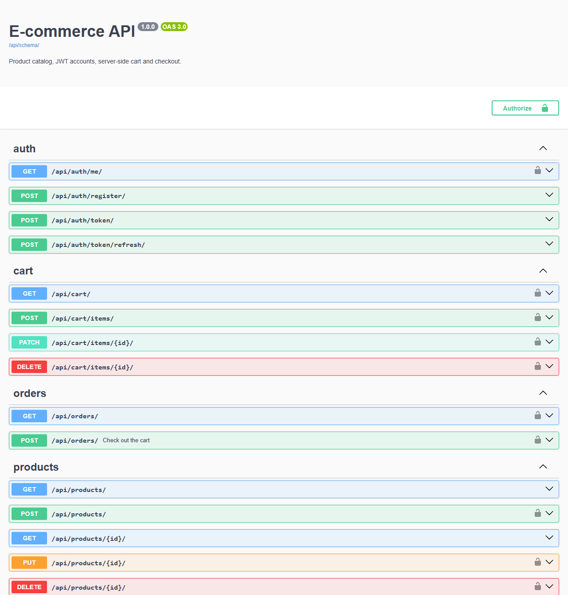

# E-commerce Backend 🛒

REST API for an online store built with **Django** and **Django REST Framework**: product catalog, customer accounts
with **JWT**, a server-side **cart** and **checkout** that turns the cart into an order and updates stock atomically.
It is the backend of [ecommerce-frontend](https://github.com/CuencaOscar/ecommerce-frontend).


## Features

- **Catalog:** public product listing and detail; only staff users can create, edit or delete products.
- **Accounts:** sign-up with Django password validation, email + password sign-in with JWT access/refresh tokens.
- **Cart:** one cart per user stored in the database, quantities validated against stock.
- **Checkout:** creates the order inside a transaction with row locks, snapshots product names and prices,
  decrements stock and empties the cart; returns `409` if stock ran out in the meantime.
- **Orders:** each customer sees only their own order history. Orders are manageable from the Django admin.
- **Interactive docs:** OpenAPI 3 schema generated with drf-spectacular, browsable in Swagger UI and ReDoc.
- 17 API tests and a GitHub Actions workflow that also checks for missing migrations.

## API

| Method | Path | Auth | Description |
|---|---|---|---|
| `GET` | `/api/products/` | — | List products |
| `GET` | `/api/products/<id>/` | — | Product detail |
| `POST` `PUT` `DELETE` | `/api/products/…` | Staff | Manage the catalog |
| `POST` | `/api/auth/register/` | — | Create an account; returns the user and a JWT pair |
| `POST` | `/api/auth/token/` | — | Sign in with `{"username": email, "password"}` |
| `POST` | `/api/auth/token/refresh/` | — | New access token from a refresh token |
| `GET` | `/api/auth/me/` | User | Current user |
| `GET` | `/api/cart/` | User | Cart items and total |
| `POST` | `/api/cart/items/` | User | Add a product (`product_id`, `quantity`) |
| `PATCH` `DELETE` | `/api/cart/items/<id>/` | User | Change quantity or remove an item |
| `GET` | `/api/orders/` | User | Order history |
| `POST` | `/api/orders/` | User | Check out the cart |

Authenticated requests send `Authorization: Bearer <access token>`.

### Interactive documentation

With the server running, the full OpenAPI 3 contract is available at:

- **Swagger UI:** `http://127.0.0.1:8000/api/docs/` (use *Authorize* with an access token to try protected endpoints)
- **ReDoc:** `http://127.0.0.1:8000/api/redoc/`
- **Schema:** `http://127.0.0.1:8000/api/schema/`



## Getting started

Requirements: Python 3.10+. The quickest way uses SQLite:

```bash
python -m venv .venv && source .venv/bin/activate   # Windows: .venv\Scripts\activate
pip install -r requirements.txt
export DJANGO_SETTINGS_MODULE=ecommerce.settings.sqlite
python manage.py migrate
python manage.py seed_products        # optional demo catalog
python manage.py createsuperuser      # staff user for the admin and catalog changes
python manage.py runserver
```

For PostgreSQL use `ecommerce.settings.local` (credentials in `ecommerce/settings/local.py`) and set
`DJANGO_SECRET_KEY` in production (see `.env.example`).

## Tests

```bash
python manage.py test --settings=ecommerce.settings.test
```

## Project structure

```
ecommerce/
├── settings/      # base, sqlite, local, development, production, test
└── urls.py        # /admin and /api routes
products/          # Product model, catalog endpoints, seed_products command
accounts/          # Registration, JWT sign-in and profile
orders/            # CartItem, Order and OrderItem; cart and checkout endpoints
```

## License

[MIT](LICENSE) © Oscar Cuenca · [LinkedIn](https://www.linkedin.com/in/ocuenca-moreno/)
