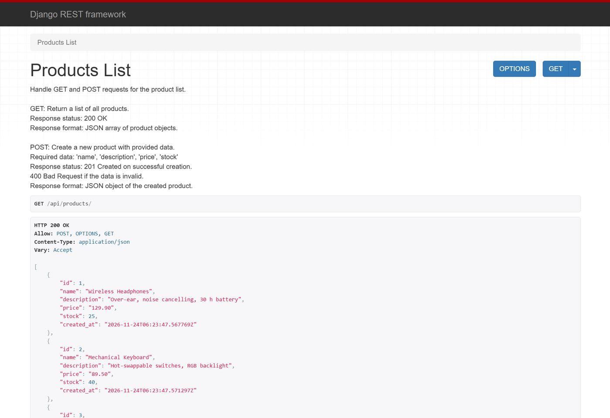

# E-commerce Backend 🛒

REST API for the product catalog of an online store, built with **Django** and **Django REST Framework**
on **PostgreSQL**. It is the backend of [ecommerce-frontend](https://github.com/CuencaOscar/ecommerce-frontend).




## Features

- Product catalog with name, description, price, stock and creation date.
- Full CRUD through DRF views with explicit status codes.
- Settings split per environment: `local`, `development` and `production`.
- Secret key read from the environment and CORS enabled for the web client.
- Django admin for managing products.

## API

| Method | Path | Description |
|---|---|---|
| `GET` | `/api/products/` | List all products |
| `POST` | `/api/products/` | Create a product (`name`, `description`, `price`, `stock`) |
| `GET` | `/api/products/<id>/` | Product detail |
| `PUT` | `/api/products/<id>/` | Update a product |
| `DELETE` | `/api/products/<id>/` | Delete a product |

## Getting started

Requirements: Python 3.10+ and a PostgreSQL database.

```bash
python -m venv .venv && source .venv/bin/activate   # Windows: .venv\Scripts\activate
pip install -r requirements.txt
cp .env.example .env                                # set DJANGO_SECRET_KEY
# Set your database credentials in ecommerce/settings/local.py
python manage.py migrate --settings=ecommerce.settings.local
python manage.py runserver --settings=ecommerce.settings.local
```

## Project structure

```
ecommerce/
├── settings/      # base, local, development, production
└── urls.py        # /admin and /api routes
products/
├── models.py      # Product model
├── serializers.py # ProductSerializer
├── views.py       # List/create and detail/update/delete endpoints
└── urls.py
```

## Roadmap

User accounts, shopping cart and orders.

---

**Oscar Cuenca** · [LinkedIn](https://www.linkedin.com/in/ocuenca-moreno/)
